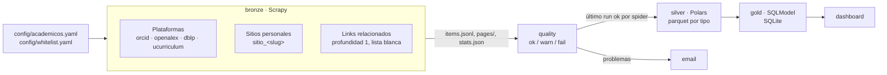

# daii

Datos para el dashboard de la **Dirección Académica, de Investigación e Innovación (DAII)** de la FCFM, U. de Chile:
académicos, afiliaciones, áreas, publicaciones, tesis, proyectos y fondos, cursos, vinculación con el medio,
productos y perfiles. Todo se obtiene con **scrapers custom por fuente** (Scrapy + Playwright) y se organiza
en una arquitectura **medallion** (bronze → silver → gold), orquestada con **Prefect**.

- Modelo conceptual: [`docs/modelo_datos.md`](docs/modelo_datos.md)
- Guía para contribuir y para agentes de código: [`AGENTS.md`](AGENTS.md)

## Inicio rápido

```bash
uv sync
uv run playwright install chromium
cp .env.example .env          # SMTP para alertas, API key OpenAlex (opcionales)
uv run daii run               # todos los spiders → data/gold/daii.sqlite
```

Otros comandos (`make help` muestra los atajos equivalentes):

```bash
uv run daii spiders                         # lista de spiders
uv run daii run --spiders orcid,ucurriculum # solo algunos
uv run scrapy crawl sitio_marcos_orchard -a persona=marcos-orchard   # un spider suelto (depuración)
uv run daii silver && uv run daii gold      # reconstruir capas sin volver a scrapear
uv run prefect server start                 # UI en http://127.0.0.1:4200
uv run daii serve --cron "0 6 * * 1"        # ejecución programada (lunes 06:00)
uv run daii explorar                        # explorador de datos (Streamlit) en http://localhost:8501
uv run pytest && uv run ruff check && uv run ty check src
```

## Python y dependencias

El proyecto usa **Python 3.14.10** (`.python-version`). `uv` lo descarga si no está instalado. `requires-python`
solo acepta 3.14.10 o un parche posterior de 3.14 (`>=3.14.10,<3.15`), así que el lock no resuelve para 3.15.
Las versiones de todas las dependencias, incluidas ruff y ty, quedan fijadas en `uv.lock`. Para actualizarlas:

```bash
uv lock --upgrade                       # dependencias
uv run pre-commit autoupdate --freeze   # hooks remotos de pre-commit
```

Para subir el parche de Python, cambia `.python-version` y el mínimo de `requires-python` en `pyproject.toml`,
y luego corre `uv lock`.

## Commits y releases

Instala los hooks locales con `uv run pre-commit install --allow-missing-config`.
Los hooks verifican portabilidad de archivos, sintaxis, claves privadas y formato. Los correctores de texto
preservan las fixtures de los scrapers tal como se descargaron.
Usa Conventional Commits en los commits y en el título de cada PR, por ejemplo `fix(bronze): valida el código de proyecto`.
GitHub solo permite squash merge y propone el título del PR como mensaje del commit en `main`.

Tras pasar el CI en `main`, Commitizen actualiza la versión del proyecto y crea un tag `vX.Y.Z`. GitHub publica
la release con un changelog generado a partir de los PR fusionados desde la release anterior.

| Título del PR | Versión |
|---|---|
| `tipo!:` o `tipo(ámbito)!:` | Major |
| `feat:`, `perf:` | Minor |
| `fix:`, `refactor:` | Patch |
| `chore:`, `docs:`, `style:`, otros | Se incluyen en la próxima release |

Si la publicación falla después de subir el tag, ejecuta el workflow **CI** manualmente sobre `main` para completarla.

## Arquitectura



| Capa | Dónde | Qué contiene |
|---|---|---|
| bronze | `data/bronze/<spider>/<run_id>/` | `items.jsonl` (ítems validados con pydantic, texto como en la fuente), `pages/` (respuestas originales gzip), `stats.json`, `quality.json` |
| silver | `data/versions/<build_id>/silver/<tipo>.parquet` | Por persona: normalizado (DOI, catálogos de tipo de publicación, nivel de formación, instrumento) y deduplicado entre fuentes, con `fuentes` y `confianza` |
| gold | `data/gold/daii.sqlite` | Modelo relacional (`src/daii/gold/models.py`): entidades compartidas (publicación, proyecto, tesis, curso, producto) con tablas puente a `academico` y estado de cada scraper (`scraperun`) |

### Deduplicación

Varias fuentes traen el mismo registro escrito distinto ("PhD" / "PhD. Computer Science", un DOI con `_15` y otro con
`-15`, el preprint arXiv y su versión publicada). Silver los fusiona en una fila. Todas las reglas viven en
`src/daii/silver/dedup.py`, cada una con un test con casos reales en `tests/test_dedup.py`.

**Cómo fusiona:**

1. Filas idénticas salvo procedencia (URL de la página, run): una sola fila, sin más.
2. Las heurísticas comparan los textos normalizados (minúsculas, sin tildes ni puntuación) con tres criterios:
   - **Iguales**: el texto normalizado coincide.
   - **Compatible** (campos secundarios): falta en una fuente, es igual, o las palabras de uno están todas en el otro
     ("16th ISWC" ⊂ "16th ISWC in 2017").
   - **Difuso** (solo textos de 4+ palabras: títulos, organizaciones, nombres): ratio `difflib` ≥ 0.95, con los mismos números (fechas, versiones,
     "Part 1") y donde las palabras distintas son typos entre sí ("Filter"/"Filtering") o uno solo agrega palabras.
     "WWW2011 Tutorial" y "ISWC2011 Tutorial" no se fusionan.
3. Cada campo de la fila fusionada sale de la fuente más prioritaria que lo trae (orden de "Conciliación"), y la
   evidencia de gold registra de qué ítem salió cada uno.

| Tabla | Mismo registro si… |
|---|---|
| publicación | mismo DOI (comparado sin puntuación, sin `/pdf`); o mismo título largo con a lo más un DOI real (se le suman las filas sin DOI y el preprint arXiv); o título difuso con año a ±1 (±2 si es arXiv); título corto ("Preface"): misma persona y año. **Dos DOIs reales distintos nunca se fusionan** (conferencia y revista extendida quedan separadas). La clave es el DOI real, si no el de arXiv, si no `t:<título>`. El tipo prefiere la versión publicada sobre el preprint |
| proyecto | mismo código (sin espacios ni guiones: `I D25I10330` = `ID25I10330`); o mismo título (o difuso) con códigos compatibles: falta uno o uno es sufijo del otro con ≥ 6 dígitos (`ACT192015` ⊂ `PIA/ACT192015`). Códigos incompatibles nunca se fusionan |
| tesis | mismo título y año (sin mirar estudiante: es la clave de siempre y no deja registro en `fusion`); mismo título (o difuso) con año a ±1 o desconocido y estudiante compatible; sin título: la única tesis de la misma persona y estudiante con nivel (doctorado/magíster/pregrado) y año compatibles |
| curso | manda el código (`clave_curso`): mismo nombre con códigos distintos (`CI41C`, `CI5101`) son cursos distintos; sin código, el nombre |
| dictación | misma persona, curso, año y semestre; los roles se unen ("Profesor Coordinador; Profesor de Cátedra") |
| formación | misma persona, nivel y año, misma institución (sin palabras genéricas: "Universidad de Chile" = "University of Chile") o sin institución; en pregrado además grado compatible (dos carreras el mismo año) |
| afiliación | organización igual o difusa, rol igual o ausente, fechas iguales o ausentes |
| distinción | mismo año, nombre igual o difuso, otorgante compatible (años distintos son premios distintos) |
| actividad | mismo tipo, título igual o difuso, misma fecha, rol compatible (no mira la URL) |
| perfil | misma plataforma y misma URL (sin `http(s)://`, `www.` ni `/` final) o mismo identificador |
| área | nombre igual o difuso |
| link, página | misma URL canónica |
| métrica, producto | sin regla (no hay duplicados) |

**Auditoría:** cada unión hecha por una heurística queda en la tabla gold `fusion` (`tabla`, `fila_id`, `item_a`,
`item_b`, `regla`, `similitud`). Las uniones por clave idéntica no dejan registro: ya se ven en `evidencia`. Se revisan
en el explorador (modo Pipeline, **Fusiones**: los dos registros tal como los trajo cada fuente, ordenados por similitud) o en SQL:
`SELECT * FROM fusion WHERE regla = 'titulo_difuso' ORDER BY similitud`. El nombre legible de cada regla está en
`config/catalogos.yaml` (`fusion.regla`), y cada build loguea `dedup_aplicado` con las filas antes/después por tabla.

**Cambiar una regla:** editar `dedup.py`, agregar el caso (uno que fusione y uno que no) a `tests/test_dedup.py`,
actualizar esta sección y, si la regla es nueva, su nombre en `catalogos.yaml`.

### Fuentes

| Spider | Fuente | Para quién |
|---|---|---|
| `orcid` | API pública ORCID v3 | quien tenga `orcid` en config |
| `openalex` | API OpenAlex (autor + obras, métricas) | quien tenga `orcid` |
| `dblp` | SPARQL oficial de DBLP | quien tenga `dblp` |
| `ucurriculum` | Fichas FCFM (`dcc.uchile.cl/nosotros/academico/...`): cursos por semestre, tesis guiadas, proyectos, publicaciones | quien tenga `ucurriculum` |
| `portafolio` | Portafolio Académico U. de Chile (fuente oficial: nombramientos, cargos, docencia U-Campus, publicaciones con indexación WoS/Scopus, proyectos, tesis, extensión). SPA: Playwright + paginación por clics | quien tenga `portafolio` |
| `cmm` | Fichas de investigadores del CMM | quien tenga `cmm` |
| `cr2` | Fichas del CR2 (papers con línea CR2, indexación y acceso abierto) | quien tenga `cr2` |
| `anid` | Portal del Investigador ANID (currículo, producción con DOI, proyectos con fuente y años; sin código ni rol) | quien tenga `anid` |
| `sitio_<slug>` | Sitio personal y CV, un spider por persona | cada académico/a |

Notas:

- **DBLP:** sus páginas HTML están detrás de Anubis, que bloquea navegadores automatizados. No se evade: se usa su endpoint SPARQL.
- **OpenAlex:** desambigua autores automáticamente y a veces mezcla homónimos. Lo que solo él reporta queda con `confianza = 0.5`.
- **Portafolio:** su API interna exige una credencial y responde ofuscada, así que no se usa directamente: se lee el DOM renderizado, como lo vería cualquier visitante.
- **Maisa Rojas:** `dgf.uchile.cl` publica un registro DNS `127.0.0.1` y tiene la cadena TLS incompleta, así que su sitio no tiene spider (la cubren ORCID y OpenAlex).
- **Google Scholar:** no se scrapea (lo prohíbe y bloquea).

### Agregar un académico

1. Agregar su entrada en `config/academicos.yaml` (slug, nombre, unidad, perfiles). Solo con eso los spiders
   de plataforma ya lo cubren.
2. Si tiene sitio propio, escribir `src/daii/bronze/spiders/sites/<slug>.py` y su test según `AGENTS.md`.

## Observabilidad

- **Prefect UI:** cada corrida, spider (`crawl-<spider>`), log y duración. Cada flow publica el artefacto
  `calidad-scrapers` con una tabla de estado por spider.
- **Logs** (`src/daii/log.py`, loguru): un mismo formato para spiders, quality, silver, gold y el flow, con
  `componente`, `evento`, `spider`, `persona` y `run_id`. Se ven en consola y Prefect, quedan en `log.jsonl` de cada
  corrida y versión, y en `data/logs.sqlite`: `uv run daii logs --nivel WARNING` o `make logs`.
- **Quality** (`src/daii/quality/checks.py`), por run:
  - `fail`: crash, 0 ítems o bajo el mínimo `expect` del spider. Ese run no se usa: silver y gold mantienen el último run `ok`.
  - `warn`: caída >50% de algún tipo, en total o para una persona, respecto al run ok anterior, ítems inválidos, excepciones en parsers, páginas propias caídas o pestañas de Portafolio incompletas. Tampoco se publica. Los links externos caídos no alertan.
- **Email:** un solo correo por corrida con los spiders en `fail`/`warn` y el run que se publica de cada uno, más otro si el pipeline se cae.
  Se configura con las variables `SMTP_*` y `ALERT_*` de `.env`.
- **Tabla `scraperun` en gold:** el dashboard puede mostrar la salud de cada fuente y la fecha de su último dato bueno.

## Pendientes conocidos

- Normalizar organizaciones (tabla `Organizacion` + ROR) y áreas a una taxonomía (OCDE/ANID).
- Coautores y estudiantes como personas propias (hoy son texto).
- Montos de proyectos: ANID publica bases abiertas que se pueden cruzar por código.
- Cursos: las fichas DCC cubren 7 años; para el resto hay que pedirle una exportación de U-Campus a la DAII.


### Versiones locales

`uv run daii silver` prepara un candidato e imprime su identificador.
`uv run daii gold --build-id <id>` publica ese candidato bajo
`DAII_DATA/versions/<id>/` y actualiza la SQLite vigente. El flow programado pasa
el identificador automáticamente. `uv run daii versions` lista los manifiestos y
`uv run daii diff <anterior> <posterior>` compara las filas de dos versiones.
`uv run daii gold --build-id <id>` con una versión ya publicada vuelve a ella (rollback) sin reconstruirla.
Una versión anterior a la vigente que nunca se publicó se rechaza.

El esquema de cada SQLite lo crean las migraciones de Alembic (`src/daii/gold/migrations/`); la tabla
`alembic_version` dice con qué revisión se construyó. Al cambiar `gold/models.py`: `make migration MSG="..."`.

La publicación selecciona la última corrida `ok` de cada spider. Un `warn` o
`fail` posterior queda visible en `scraperun` y se conserva la corrida `ok`
previa. El manifiesto fija las corridas antes de leer los Parquet en Gold.
