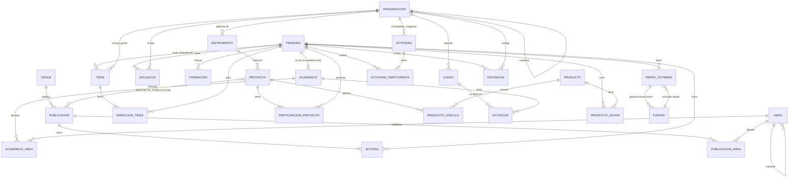
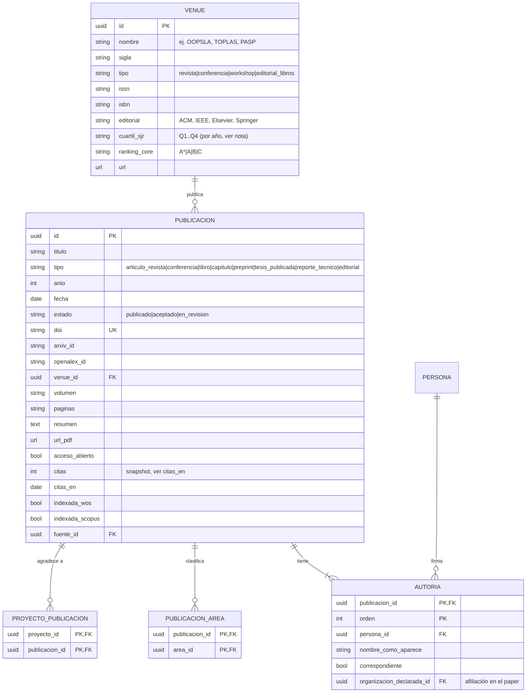
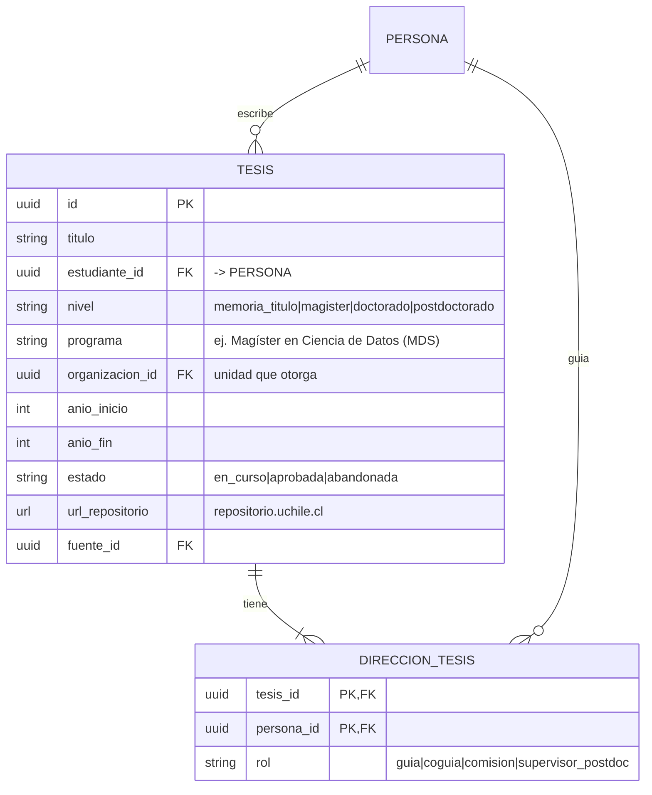
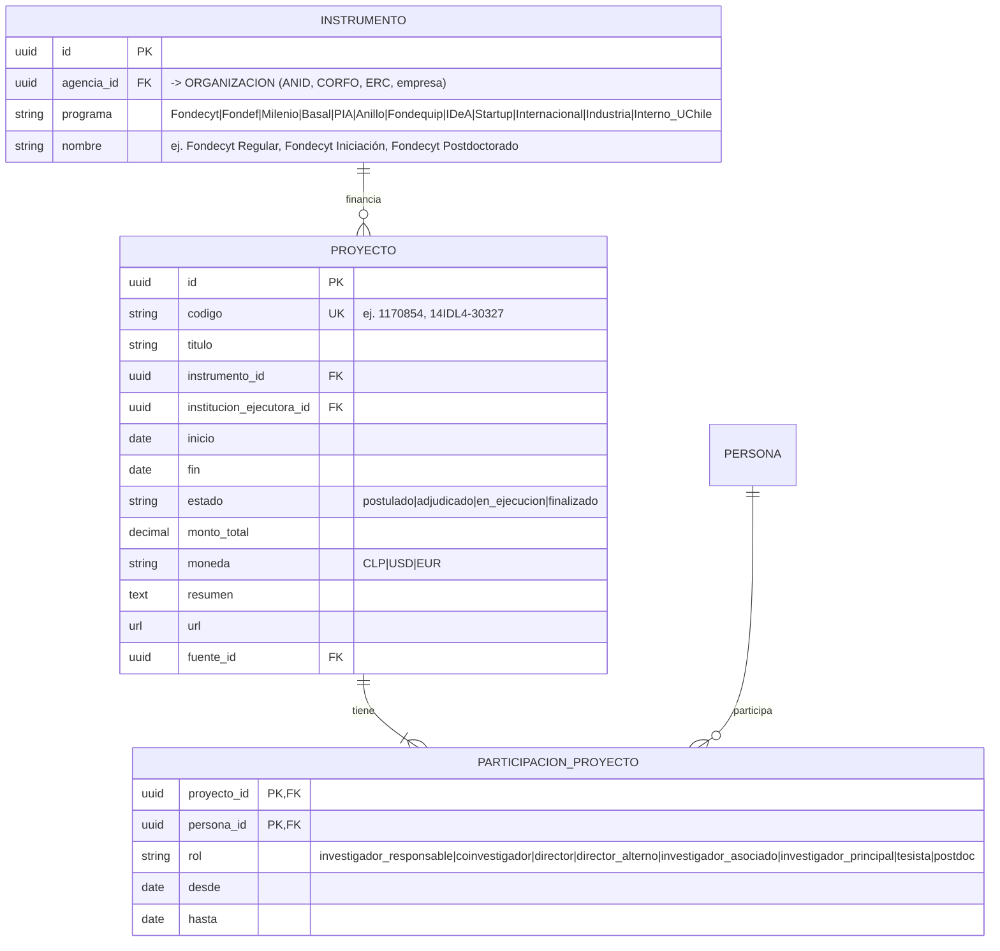
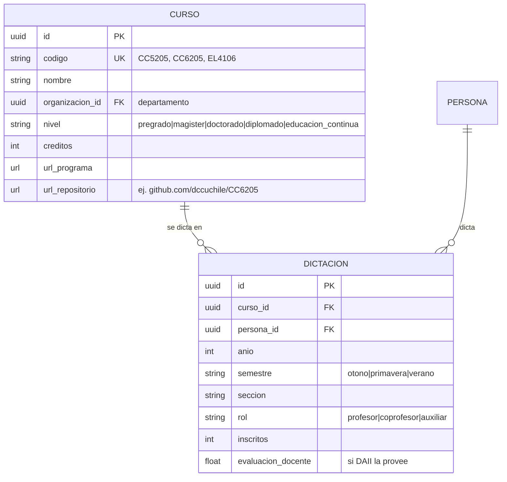
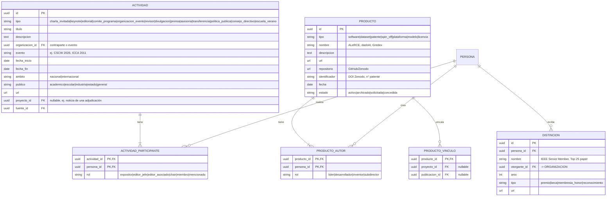
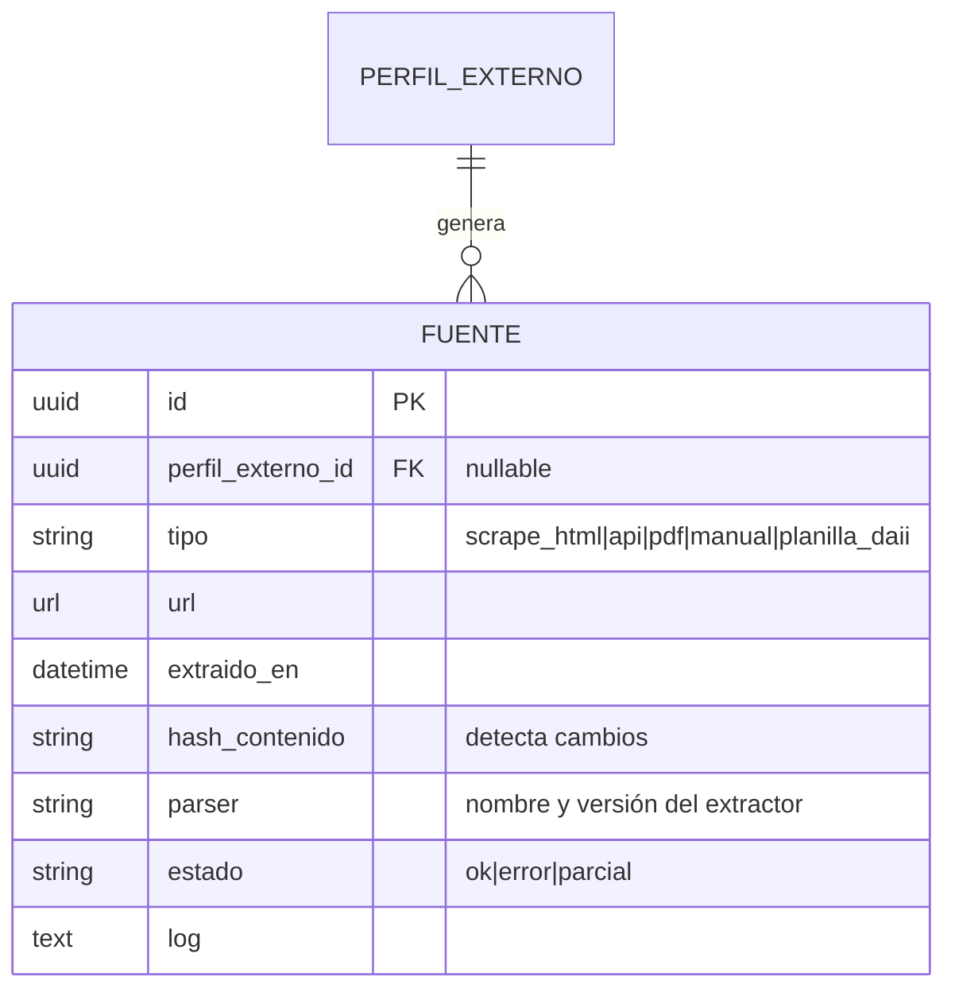

# Modelo de datos — Dashboard DAII (FCFM, U. de Chile)

Objetivo: que la Dirección Académica, de Investigación e Innovación (DAII) pueda ver, por académico/a, unidad o área: afiliaciones, áreas de investigación, publicaciones, tesis guiadas, proyectos y fondos, cursos, vinculación con el medio, productos (software, datos, patentes) y perfiles en la web.

Construido a partir de los sitios de ejemplo (Bravo-Marquez, Toro, Ruiz del Solar, López Moncada, Förster, Verschae, Silva, Orchard). Lo que aparece en esos sitios y define el modelo:

| Lo que vimos | Ejemplo | Dónde queda en el modelo |
|---|---|---|
| Muchas afiliaciones a la vez, con roles | Bravo: Prof. Asociado DCC + Director IDIA + Investigador Principal CENIA + Investigador IMFD + fundador ReLeLa | `AFILIACION` (persona ↔ organización, rol, fechas) |
| Trayectoria previa en otras universidades | Verschae: Kyoto → UOH → UTFSM → IDIA (2026) | `AFILIACION` con `hasta` |
| Organizaciones anidadas | IDIA ⊂ FCFM ⊂ U. de Chile; grupos PLEIAD, ReLeLa | `ORGANIZACION.padre_id` |
| Proyectos con roles y códigos | Silva: Fondecyt 1170044, Co-PI, PI = Orchard | `PROYECTO` + `PARTICIPACION_PROYECTO` (conecta académicos entre sí) |
| Publicaciones con DOI y PDF | Toro: OOPSLA, POPL, TOPLAS, ICFP… | `PUBLICACION` + `VENUE` + `AUTORIA` |
| Cargos editoriales y comités | Orchard: Editor-in-Chief IJPHM; López: Senior PC CSCW 2026; Silva: AE IEEE TSP | `ACTIVIDAD` (tipo `editorial`, `comite_programa`) |
| Charlas y divulgación | Orchard: keynotes, escuelas de verano; Ruiz del Solar: robótica con niños | `ACTIVIDAD` (tipo `charla`, `divulgacion`) |
| Software y plataformas | ALeRCE (Förster), dashAI (López), Gredex (Toro) | `PRODUCTO` |
| Premios | Silva: IEEE Senior Member, Top 25 Speech Communication | `DISTINCION` |
| Grados y tesis propias | Silva: PhD USC 2008 + título de la tesis | `FORMACION` |
| Muchos perfiles externos | ORCID, Scholar, DBLP, Scopus, WoS, ADS, ACL Anthology, GitHub… | `PERFIL_EXTERNO` (también es la semilla del scraper) |
| Noticias de adjudicaciones | DCC: Toro y Barriere ganan Fondecyt de Iniciación 2025 | `ACTIVIDAD` (tipo `prensa`) enlazada a `PROYECTO` |
| Ficha institucional estructurada (DCC) | Cerda: nombramiento "Profesor Asociado (DCC/IDIA)", grados con año, cursos con código y semestres impartidos, memorias y tesis guiadas con año, proyectos y publicaciones | `ACADEMICO`, `FORMACION`, `CURSO` + `DICTACION`, `TESIS` + `DIRECCION_TESIS`, `PROYECTO` |
| Docencia fuera de la FCFM | Cerda: cursos de Medicina (ME…, TM…, Magíster en Informática Médica) | `CURSO.organizacion_id` puede apuntar a otra facultad |
| Doble adscripción | Cerda, Bravo, López: DCC + IDIA | `AFILIACION` con dos filas vigentes y `ACADEMICO.unidad_principal_id` |

## Decisiones de diseño

1. **Usamos `PERSONA` para todos y `ACADEMICO` como extensión.** Los coautores externos, los estudiantes tesistas y los co-PI de otras universidades también son personas. Así una autoría, una tesis o un proyecto apuntan siempre a `PERSONA`, y el dashboard filtra por `ACADEMICO` cuando corresponde. Esto permite armar redes de colaboración (por ejemplo Silva ↔ Orchard) sin duplicar datos.
2. **Una sola tabla `ORGANIZACION` con `tipo` y `padre_id`.** Cubre universidades, facultades, departamentos, centros, institutos Milenio, laboratorios, agencias (ANID, CORFO), empresas y sociedades (IEEE, PHM Society).
3. **Trazabilidad en todo.** Toda fila extraída lleva `fuente_id` (→ `FUENTE`), `extraido_en` y `confianza`. El dato puede venir de un scrapeo, de una API (ORCID/OpenAlex) o de ingreso manual. Cuando dos fuentes no coinciden, gana `verificado = true` (validación humana).
4. **Deduplicación por identificadores persistentes.** DOI para publicaciones, ORCID para personas, ROR para organizaciones, código ANID para proyectos y ISSN/ISBN para venues.
5. **Usamos catálogos y no texto libre** donde el dashboard agrega: jerarquía, tipo de publicación, instrumento de financiamiento, área (OCDE/FORD) y nivel de tesis.

---

## 1. Vista general (relaciones)



> Por legibilidad, el diagrama no dibuja las flechas `fuente_id` → `FUENTE`, pero todas las entidades extraídas tienen esa columna.

---

## 2. Personas, afiliaciones y áreas

```mermaid
erDiagram
    PERSONA {
        uuid id PK
        string nombres
        string apellidos
        string nombre_citacion "ej. Bravo-Marquez, F."
        string orcid UK "nullable"
        string email
        string genero "nullable, para indicadores de equidad"
        string pais
        url foto_url
        text bio
        uuid fuente_id FK
        datetime actualizado_en
    }
    ACADEMICO {
        uuid persona_id PK, FK
        string rut UK "solo si DAII lo provee"
        uuid unidad_principal_id FK "-> ORGANIZACION (depto/IDIA)"
        string jerarquia "Titular|Asociado|Asistente|Instructor|Adjunto"
        string carrera "ordinaria|docente|adjunta"
        int jornada_horas "22|33|44"
        date fecha_ingreso
        date fecha_salida "nullable"
        url sitio_web
        url cv_url
        bool activo
    }
    ORGANIZACION {
        uuid id PK
        string nombre
        string sigla "DCC, DIE, IDIA, CENIA, IMFD, MAS"
        string tipo "universidad|facultad|departamento|iniciativa|centro|instituto_milenio|centro_basal|laboratorio|grupo|agencia|empresa|sociedad|editorial"
        uuid padre_id FK "nullable"
        string ror_id UK "nullable"
        string pais
        url url
        bool es_interna "pertenece a FCFM"
    }
    AFILIACION {
        uuid id PK
        uuid persona_id FK
        uuid organizacion_id FK
        string rol "profesor|director|subdirector|investigador_principal|investigador_asociado|investigador_adjunto|miembro_fundador|coordinador_academico|postdoc|visitante"
        string cargo_texto "texto original"
        date desde
        date hasta "nullable = vigente"
        bool es_principal
        uuid fuente_id FK
    }
    FORMACION {
        uuid id PK
        uuid persona_id FK
        string grado "licenciatura|titulo_profesional|magister|doctorado|postdoctorado"
        string disciplina
        uuid organizacion_id FK
        int anio_inicio
        int anio_fin
        string titulo_tesis
        string supervisor_texto
    }
    AREA {
        uuid id PK
        string nombre
        string taxonomia "OCDE_FORD|ANID|ACM_CCS|libre"
        string codigo "ej. 1.2 / 2.2"
        uuid padre_id FK
    }
    ACADEMICO_AREA {
        uuid persona_id PK, FK
        uuid area_id PK, FK
        bool declarada "true=autodeclarada, false=inferida de publicaciones"
        float peso
    }
    PERFIL_EXTERNO {
        uuid id PK
        uuid persona_id FK
        string plataforma "orcid|scholar|dblp|scopus|wos|openalex|semantic_scholar|researchgate|ads|acl_anthology|github|linkedin|bluesky|youtube|sitio_personal|cv_pdf|portafolio_uchile|ucampus"
        string identificador "ej. 0000-0002-2153-4306"
        url url
        datetime ultima_extraccion
        string estado "pendiente|ok|error|bloqueado"
    }

    PERSONA ||--o| ACADEMICO : es
    PERSONA ||--o{ AFILIACION : tiene
    ORGANIZACION ||--o{ AFILIACION : recibe
    ORGANIZACION ||--o{ ORGANIZACION : contiene
    ORGANIZACION ||--o{ ACADEMICO : "unidad principal"
    PERSONA ||--o{ FORMACION : obtuvo
    ORGANIZACION ||--o{ FORMACION : otorga
    ACADEMICO ||--o{ ACADEMICO_AREA : declara
    AREA ||--o{ ACADEMICO_AREA : clasifica
    AREA ||--o{ AREA : subarea
    PERSONA ||--o{ PERFIL_EXTERNO : tiene
```



---

## 3. Producción científica



> El cuartil y el ranking CORE cambian cada año. Si el dashboard debe mostrar el cuartil vigente al publicar, conviene una tabla `VENUE_METRICA(venue_id, anio, cuartil, sjr, jif)`. Por ahora queda como atributo simple.

---

## 4. Formación de capital humano (tesis)



---

## 5. Proyectos y financiamiento



> Los centros Basal o Milenio (CENIA, IMFD, MAS, AMTC) son a la vez `ORGANIZACION` (para afiliarse) y `PROYECTO` (para contar la adjudicación y el monto). Ambos registros se conectan con `PROYECTO.institucion_ejecutora_id`, o se reconocen por compartir la sigla.

---

## 6. Docencia



---

## 7. Vinculación con el medio, productos y distinciones



---

## 8. Trazabilidad y scraping



Columnas comunes en todas las entidades extraídas: `fuente_id`, `extraido_en`, `confianza` (0–1) y `verificado` (bool, validación humana).

---

## 9. Preguntas que el dashboard debe poder responder

- ¿Cuántas publicaciones WoS/Scopus Q1 tuvo cada departamento o área en los últimos 5 años? → `PUBLICACION` × `AUTORIA` × `ACADEMICO.unidad_principal_id` × `VENUE`
- ¿Quiénes tienen un Fondecyt vigente como IR y cuánto suman los montos? → `PROYECTO` × `PARTICIPACION_PROYECTO` × `INSTRUMENTO`
- ¿Qué académicos colaboran entre sí, dentro o fuera de su departamento? → `AUTORIA` y `PARTICIPACION_PROYECTO` (grafo persona–persona)
- ¿Cuántas tesis de doctorado o magíster guía cada académico? → `DIRECCION_TESIS` × `TESIS`
- ¿Quiénes trabajan en IA, astro o energía y en qué centros participan? → `ACADEMICO_AREA` + `AFILIACION`
- ¿Qué carga docente tiene cada académico por semestre? → `DICTACION`
- ¿Qué vinculación con el medio y qué productos de transferencia hay? → `ACTIVIDAD`, `PRODUCTO`
- ¿Qué perfiles están desactualizados o tienen datos sin verificar? → `PERFIL_EXTERNO.ultima_extraccion`, `verificado`

---

## 10. Links para scrapear

### 10.1 Fuentes generales (para todo el cuerpo académico)

| Fuente | URL | Qué entrega | Cómo |
|---|---|---|---|
| Cuerpo académico FCFM | https://ingenieria.uchile.cl/sobre-la-fcfm/organizacion/personas/cuerpo-academico | Lista de académicos por departamento (semilla de `ACADEMICO`) | HTML |
| Ejemplo por depto. (DCC) | http://ingenieria.uchile.cl/sobre-la-fcfm/organizacion/personas/cuerpo-academico/ciencias-de-la-computacion | Ficha individual (`?qui_id=`) | HTML |
| Portafolio académico U. de Chile | https://www.uchile.cl/portafolio-academico/perfilAcademico.jsf?username={user} | Jerarquía, grados, publicaciones y proyectos declarados | HTML |
| IDIA – Iniciativa de Datos e IA | https://idia.uchile.cl/ | Académicos IDIA | HTML |
| **DCC – fichas de académicos** | https://dcc.uchile.cl/nosotros/academicos/ → https://dcc.uchile.cl/nosotros/academico/{slug}/ | **La mejor fuente estructurada:** nombramiento, grados, cursos por semestre (últimos 7 años), tesis guiadas, proyectos y publicaciones. El índice enlaza a unas 26 fichas | HTML |
| U-Cursos (público) | http://www.u-cursos.cl/ingenieria/{codigo}/ | Página y programa de cada curso | HTML |
| uPapers DCC | https://upapers.dcc.uchile.cl/ | Publicaciones del DCC | HTML |
| DCC – Fondecyt/Fondef/Laboratorios | https://dcc.uchile.cl/ (menú Investigación) | Proyectos y laboratorios del depto. | HTML |
| DCC – académicos y noticias | https://dcc.uchile.cl/ · https://comunicaciones.dcc.uchile.cl/news/ | Personas y prensa (adjudicaciones) | HTML |
| Noticias FCFM | https://ingenieria.uchile.cl/noticias/ | Prensa, vinculación | HTML |
| Repositorio de tesis U. de Chile | https://repositorio.uchile.cl/ | Tesis, guías, año | OAI-PMH: https://repositorio.uchile.cl/oai/request |
| U-Campus / catálogo de cursos | https://ucampus.uchile.cl/ | Cursos y dictaciones (requiere acceso; mejor exportado por DAII) | manual/API interna |
| ANID – Repositorio | https://repositorio.anid.cl/ | Proyectos Fondecyt/Fondef con código, IR y monto | HTML/OAI |
| ANID – Datos abiertos | https://github.com/ANID-GITHUB | Bases históricas de proyectos adjudicados (CSV) | CSV |
| ORCID API pública | https://pub.orcid.org/v3.0/{orcid}/works | Trabajos, empleos, educación, fondos | JSON |
| OpenAlex | https://api.openalex.org/authors?filter=orcid:{orcid} · https://api.openalex.org/works?filter=author.id:{id} | Publicaciones, citas, venues, temas, instituciones (ROR) | JSON, gratis |
| OpenAlex – institución U. de Chile | https://api.openalex.org/institutions/ror:047gc3g35 | Toda la producción UChile para cruzar | JSON |
| Crossref | https://api.crossref.org/works/{doi} | Metadatos por DOI y fondos declarados (funder) | JSON |
| DBLP | https://dblp.org/pid/{pid}.xml | Publicaciones de computación | XML |
| Semantic Scholar | https://api.semanticscholar.org/graph/v1/author/{id}/papers | Papers y citas | JSON |
| NASA ADS | https://ui.adsabs.harvard.edu/ (API: https://api.adsabs.harvard.edu/v1/) | Astronomía (Förster) | JSON, requiere token |
| ACL Anthology | https://aclanthology.org/people/ | NLP | HTML/BibTeX |
| ROR | https://api.ror.org/organizations?query={nombre} | Normalizar `ORGANIZACION` | JSON |
| Scimago (SJR) | https://www.scimagojr.com/journalrank.php | Cuartiles por año | CSV |
| CORE Rankings | https://portal.core.edu.au/conf-ranks/ | Ranking de conferencias | CSV |
| Google Scholar | https://scholar.google.com/citations?user={id} | Citas, índice h | HTML; bloquea scrapers, usar con moderación o como fallback |
| CENIA / IMFD / MAS / CMM / AMTC | https://www.cenia.cl · https://imfd.cl · https://astrofisicamas.cl · https://www.cmm.uchile.cl · http://www.amtc.cl | Afiliaciones a centros | HTML |

### 10.2 Semillas por académico (encontradas en el scrapeo)

```yaml
- nombre: Felipe Bravo-Marquez
  unidad: DCC / IDIA (Director)
  sitio: https://felipebravom.com/
  cv: https://felipebravom.com/cv/        # sección CV web/PDF en el sitio
  orcid: 0000-0002-2153-4306
  scholar: https://scholar.google.com/citations?user=q--XWcQAAAAJ
  dblp: https://dblp.org/pid/04/8612.html
  scopus: https://www.scopus.com/authid/detail.uri?authorId=36627971200
  semantic_scholar: https://www.semanticscholar.org/author/Felipe-Bravo-Marquez/2998375
  wos: https://www.webofscience.com/wos/author/record/1907195
  acl: https://aclanthology.org/people/f/felipe-bravo-marquez/
  github: https://github.com/felipebravom
  portafolio_uchile: http://www.uchile.cl/portafolio-academico/perfilAcademico.jsf?username=felipebravom
  fcfm: http://ingenieria.uchile.cl/sobre-la-fcfm/organizacion/personas/cuerpo-academico/ciencias-de-la-computacion?qui_id=121
  imfd: https://imfd.cl/en/investigador/felipe-bravo-marquez/
  cursos: [https://github.com/dccuchile/CC5205/, https://github.com/dccuchile/CC6104, https://github.com/dccuchile/CC6205/, https://github.com/dccuchile/PerspectivasIA]
  afiliaciones: [DCC, IDIA, CENIA, IMFD, ReLeLa (https://relela.com), Waikato AI Institute]

- nombre: Matías Toro
  unidad: DCC (PLEIAD)
  sitio: https://matiastoro.github.io/   # tiene secciones Papers, Students, Projects, Teaching
  orcid: 0000-0002-5315-0198
  scholar: https://scholar.google.com/citations?user=hRPJ-ZIAAAAJ
  dblp: https://dblp.org/pid/169/6836.html
  github: https://github.com/matiastoro
  grupo: https://pleiad.cl
  papers_pdf: http://pleiad.dcc.uchile.cl/papers/   # patrón {anio}/{autor}-{venue}{anio}.pdf
  prensa:
    - https://comunicaciones.dcc.uchile.cl/news/958-profesores-matias-toro-y-valentin-barriere-se-adjudicaron-fondecyt-de-iniciacion-2025/
    - https://ingenieria.uchile.cl/noticias/212487/investigadoresas-fcfm-realizaran-proyectos-con-instituciones-alemanas

- nombre: Javier Ruiz del Solar
  unidad: DIE / AMTC (Director Ejecutivo)
  sitio: https://www.cec.uchile.cl/~jruizd/
  links: [http://www.amtc.cl, http://www.robocup.cl, http://vision.die.uchile.cl, http://www.robot.cl, http://ewh.ieee.org/reg/9/robotica]
  nota: sitio antiguo y con poca información; completar con ORCID/OpenAlex/portafolio

- nombre: Claudia López Moncada
  unidad: DCC / IDIA
  sitio: https://claudialopezmoncada.com/    # devuelve 429 si se piden muchas páginas seguidas: aplicar rate limit
  secciones: [bio/, news/, outreach/, publications/, research/, students/, teaching/]
  scholar: https://scholar.google.com/citations?user=vw1dhvcAAAAJ
  linkedin: https://www.linkedin.com/in/claudia-lopez-0218164/
  afiliaciones: [CENIA, ASOR (Instituto Milenio), ChileWiC (https://chilewic.cl/), dashAI (https://www.dash-ai.com/)]
  vinculacion: [CSCW 2026 Senior PC (https://cscw.acm.org/2026/)]

- nombre: Francisco Förster Burón
  unidad: IDIA / CMM; Director MAS
  sitio: https://fforster.github.io/
  orcid: 0000-0003-3459-2270
  scholar: https://scholar.google.com/citations?user=ptRI8_sAAAAJ
  ads: https://ui.adsabs.harvard.edu/search/q=author%3A%22forster%2C%20f%22%20collection%3Aastronomy%20property%3Arefereed
  github: https://github.com/fforster
  productos: [https://alerce.science/, https://alerce.science/high-cadence-transient-survey-hits/]
  afiliaciones: [MAS (https://astrofisicamas.cl/), CMM, CATA (https://cata.cl/), MDS (https://mds.uchile.cl/)]

- nombre: Rodrigo Verschae
  unidad: IDIA (desde agosto 2026)
  sitio: https://rodrigo.verschae.org/
  secciones: [publications/, research/, news/]
  feed: https://rodrigo.verschae.org/feed.xml
  orcid: 0000-0002-1661-3309
  scholar: https://scholar.google.com/citations?user=Fv1lZNkAAAAJ
  scopus: https://www.scopus.com/authid/detail.uri?authorId=8436903800
  wos: https://www.webofscience.com/wos/author/record/K-4469-2012
  researchgate: https://www.researchgate.net/profile/Rodrigo-Verschae
  lab: https://sites.google.com/uoh.cl/uoh-ris-lab/

- nombre: Jorge F. Silva
  unidad: DIE (Information and Decision Systems Group)
  cv: https://jorgesil77.github.io/files/cv.pdf    # PDF: formación, proyectos con código Fondecyt y rol, distinciones, publicaciones
  sitio: https://jorgesil77.github.io/
  nota: el CV es de ~2019; contrastar con ORCID/OpenAlex

- nombre: Marcos E. Orchard
  unidad: DIE; Director CASE
  sitio: https://www.morchard.cl/
  secciones:
    - https://www.morchard.cl/about-me/
    - https://www.morchard.cl/research-experience/
    - https://www.morchard.cl/awards-distinctions/
    - https://www.morchard.cl/journal-publications/
    - https://www.morchard.cl/conference-articles/
    - https://www.morchard.cl/books-books-chapters/
    - https://www.morchard.cl/teaching/
    - https://www.morchard.cl/dissemination-and-transfer/
  wp_api: https://www.morchard.cl/wp-json/wp/v2/pages   # WordPress: contenido en JSON, más fácil que parsear HTML
  researcher_id: H-4418-2013
  publons: https://publons.com/researcher/2628696/marcos-e-orchard/
  afiliaciones: [CASE (https://centroelectromovilidad.cl/), AC3E USM (http://ac3e.usm.cl/), Centro de Energía (http://centroenergia.cl/), PHM Society (https://www.phmsociety.org/journal)]

- nombre: Mauricio Cerda Villablanca
  unidad: DCC / IDIA (Profesor Asociado)
  ficha_dcc: https://dcc.uchile.cl/nosotros/academico/mauricio-cerda/   # secciones: Títulos y Grados, Docencia, Memorias y Tesis, Proyectos de Investigación, Publicaciones
  linkedin: https://www.linkedin.com/in/mauricio-cerda-villablanca-532b35178/
  grados: [Doctor Université Nancy 2 (2011), Ing. Civil en Computación U. de Chile (2007), Licenciado U. de Chile (2005)]
  cursos_ucursos: [http://www.u-cursos.cl/ingenieria/CC5205/, http://www.u-cursos.cl/ingenieria/CC5509/, http://www.u-cursos.cl/ingenieria/CC66Q/]
  nota: área informática médica y biomedicina. Dicta cursos en Medicina y guía muchas tesis aplicadas a salud
```

### 10.3 Estrategia de extracción sugerida

1. **Lista de académicos:** cuerpo académico FCFM más IDIA → `PERSONA`/`ACADEMICO` + `PERFIL_EXTERNO(fcfm)`. Para el DCC, las fichas `dcc.uchile.cl/nosotros/academico/{slug}/` llenan directamente `FORMACION`, `DICTACION` y `TESIS`. Hay que revisar si los demás departamentos tienen fichas equivalentes.
2. **Identificadores:** buscar el ORCID (sitio personal → ORCID search API) y luego el ID de autor en OpenAlex.
3. **Publicaciones:** usar OpenAlex como fuente principal y deduplicar por DOI. Completar con DBLP, ADS y ACL según el área. Clasificar con cuartiles SJR y ranking CORE.
4. **Proyectos:** usar el CSV de ANID y buscar por nombre del IR. Completar con los proyectos que figuran en el CV y en el portafolio.
5. **Tesis:** cosechar `repositorio.uchile.cl` vía OAI-PMH y hacer match del campo "profesor guía" con `PERSONA`.
6. **Sitios personales y CVs:** usar un extractor con LLM que reciba el HTML o PDF y devuelva JSON según este esquema, con `confianza` y validación humana.
7. **Cursos:** pedir a DAII una exportación desde U-Campus, porque no son públicos de forma estructurada.
